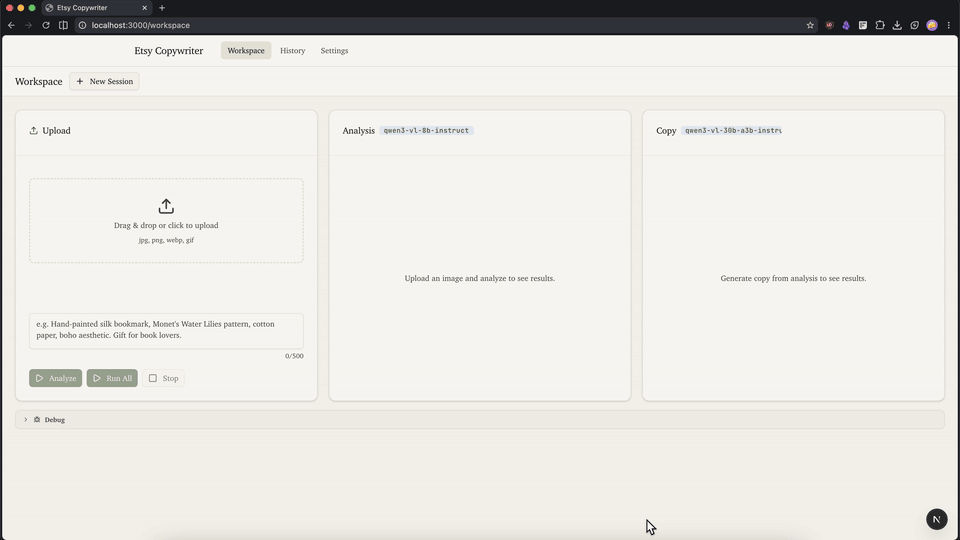

# Etsy Copywriter

Upload a product photo, get a structured description back, then turn it into Etsy listing copy. Single-page workspace, streaming output, dark mode, history.

[](https://streamable.com/5ancqs)

**▶ Full demo — 52s:** [Streamable](https://streamable.com/5ancqs) (online, expires after 90 days) · [repo MP4](docs/demo/demo.mp4) (permanent)


## Features

- **Upload → structured description** — Vision model reads a product photo and extracts subject, product type, medium, artistic style, colors, and keywords.
- **Tell it what it's looking at** — Optional text field to describe the product. Helps the vision model get it right, then passes the same context to the copy model.
- **See results as they arrive** — Output streams token by token. No spinner-and-wait.
- **Fix the AI's guesses** — All description fields are editable before generating copy.
- **Generate listing copy** — LLM writes 3 title options, SEO tags, and a product description from the description.
- **One-shot workflow** — "Run All" does upload → describe → copy → save in one click.
- **Model settings per session** — Swap model, base URL, and API key for vision and copy independently. Sent as a header on every request.
- **Session history** — Stored in localStorage (max 20, oldest dropped). Grouped by image. Group titles are editable. Past sessions open as read-only with prev/next navigation.
- **Not just for Etsy** — Schemas and prompts are plain code in `lib/schemas.ts`, `lib/getImageAnalysis.ts`, and `lib/getCopyWritings.ts`. Swap the Zod schemas and prompt text to turn this into a different structured extraction → generation pipeline: product reviews, listings, reports, whatever.
- **Dark mode** — Persisted to localStorage.
- **Kami design system** — Parchment background, ivory cards, sage green accent, serif type.

## Architecture

```
UploadZone ──userText──▶ useWorkspace ──▶ usePipeline
                    │                      ├── startAnalysis()  → POST /api/analyze-image
                    │                      ├── startCopy()      → POST /api/generate-copy
                    │                      └── runAll()         → both sequentially
                    │
                    ▼
            ┌────────────── API ──────────────────┐
            │  parseSettingsFromRequest()          │
            │    → decode X-LLM-Config header      │
            │    → createProvider()                │
            │    → streamObject() + toTextStreamResponse()
            └──────────────────────────────────────┘
                    │
            ┌───────┴────────┐
            ▼                ▼
 lib/getImageAnalysis.ts   lib/getCopyWritings.ts
   Vision model (Qwen)       LLM (Qwen)
   6-field schema            3-key schema
   userText as ground truth  userText as context
```

**Why it works this way:**

- **`streamObject` + `toTextStreamResponse()`** — `streamObject` is deprecated but kept because Qwen via OpenRouter ignores `response_format: json_schema`. The Zod schema lives in the system prompt instead. `toTextStreamResponse()` streams raw JSON; the client parses it progressively with `useObject`.
- **No server-side `.object` await** — That promise never resolves with Qwen/OpenRouter, so Run All runs client-side as two sequential fetches instead of going through a `/api/run-all` endpoint.
- **Per-request LLM config** — Settings (model, baseURL, API key) are serialized into an `X-LLM-Config` header. The server decodes and validates it with Zod. If the API key is empty, it falls back to `OPENROUTER_API_KEY`.
- **Client-side history** — Sessions in localStorage with 200×200 JPEG thumbnails. LRU eviction at 20.

## Stack

- **Framework:** Next.js 16 (App Router)
- **AI SDK:** `ai` v6 + `@ai-sdk/react` + `@ai-sdk/openai-compatible`
- **Styling:** Tailwind CSS 4 + shadcn/ui + Kami design system
- **Provider:** Any OpenAI-compatible endpoint (default: OpenRouter)
- **Validation:** Zod
- **Test:** Vitest

## Getting Started

```bash
pnpm install
cp .env.example .env    # add your OPENROUTER_API_KEY
pnpm dev                # → http://localhost:3000
```

```env
# .env
OPENROUTER_API_KEY=sk-or-...
```

The settings page UI can override the API key per session.

```bash
pnpm test    # Vitest
pnpm lint    # ESLint
pnpm build   # Production build
```

## Additional Notes

- **Supported images:** `jpg`, `png`, `webp`, `gif` — validated via `fileTypeFromBuffer`.
- **Default models:** Vision — `openrouter/quasar-alpha` (or `qwen/qwen3-vl-8b-instruct`), Copy — `openrouter/quasar-alpha` (or `qwen/qwen3-vl-30b-a3b-instruct`). Swap in Settings.
- **Debug:** Console logs tagged `[PIPELINE]`. Collapsible `<DebugPanel>` at the bottom of the workspace shows stage, errors, and raw JSON.
- **Type errors:** If the model returns invalid JSON, `useObject.onFinish` shows a `TypeValidationError` banner instead of silently showing empty fields.
- **Architecture Decision Records** in [`docs/adr/`](docs/adr/) — covers why API routes over server actions, why client-side Run All, the config header approach, and the Kami design choices.
